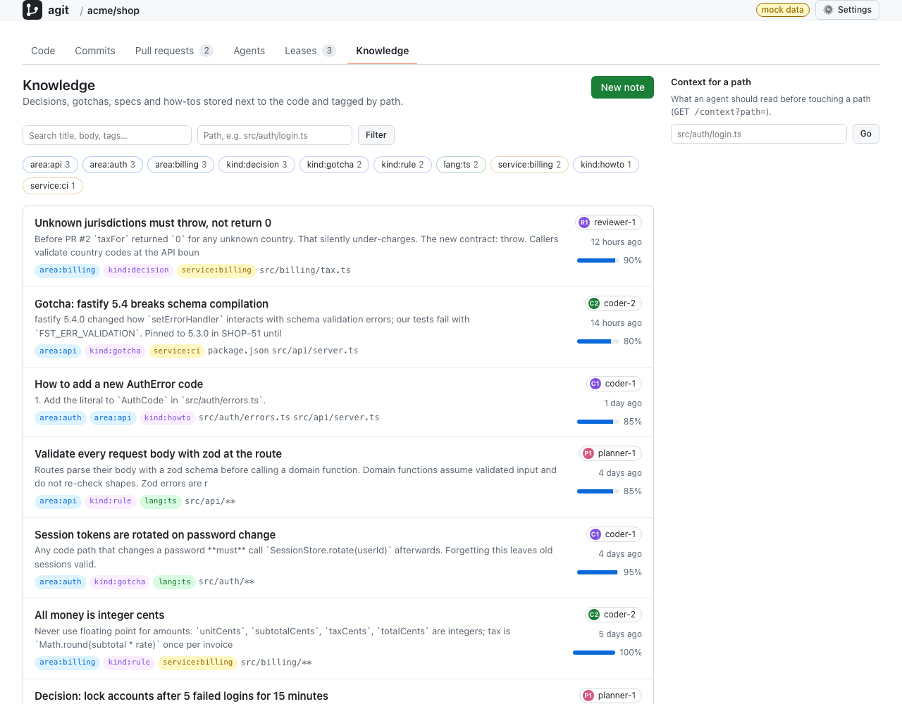

# agit

**Version control and collaboration for AI agents. Same workflow as git, re-engineered for machines.**

agit is an open-source version control system and platform that keeps the git mental model (init, add, commit, branch, merge, push, pull) and rebuilds everything underneath for a world where the committers are AI agents making thousands of tiny changes in parallel. Every command speaks JSON, every error has a stable code, every commit carries intent and agent identity, and agents coordinate through leases, workspaces, checkpoints and a live event stream instead of discovering conflicts after the fact. The throughput target is 100,000 micro-commits per second platform-wide.

> **Status (2026-10-19): the local core, the single-node server and the platform are built; replication and the 1.0 format freeze are not.** In Rust: object model with pack segments and a group-commit journal, index with tree cache, commit, status, diff, blame, merge, stash, revert, reflog, gc, leases, events, workspaces, checkpoints, Ed25519 signatures, `--json` everywhere; a hosting server (`agit-server`) with clone/push/pull, compare-and-swap refs, pull requests with reviews and server-side merge, policies, webhooks, server-wide leases, an SSE event stream, a knowledge base with BM25 search and context packs, and **SSH-key authentication with per-repository scopes**; an MCP server and Claude Code hooks; Python and TypeScript SDKs; a web UI; a git bridge. Measured numbers are in [docs/BENCHMARKS.md](docs/BENCHMARKS.md). Open: Raft replication, blob tiers, sharding, the spec and 1.0. See [Roadmap](#roadmap).

**Documentation:** the complete [handbook](docs/handbook/README.md) (installation, quickstarts for developers and agents, concepts, CLI/MCP/HTTP/SDK references, knowledge base, multi-agent workflows, administration, internals, FAQ) and a German overview, [Überblick auf Deutsch](docs/handbook/de/UEBERBLICK.md). Published at https://shadow-kernel.github.io/agit/ once GitHub Pages is enabled for the repository.

Legend used throughout this document and the docs:

| Mark | Meaning |
| --- | --- |
| ✅ | built, in `crates/agit-core`, `crates/agit-cli`, `crates/agit-protocol` or `crates/agit-server` today |
| 🚧 | in progress on `main` |
| 📋 | planned, designed in `docs/` but not implemented |

---

## Table of contents

- [Why agit](#why-agit)
- [What agit is](#what-agit-is)
- [Quick start](#quick-start)
- [Core concepts](#core-concepts)
- [For AI agents](#for-ai-agents)
- [Platform](#platform)
- [Performance goals](#performance-goals)
- [Repository layout](#repository-layout)
- [Comparison with git](#comparison-with-git)
- [Roadmap](#roadmap)
- [Dogfooding](#dogfooding)
- [Contributing](#contributing)
- [License](#license)

---

## Why agit

git is the best developer tool of the last twenty years. It was designed for humans who type a handful of commits a day, read prose output, and clean up after themselves. Agents are a different kind of user: they make thousands of tiny changes, run in parallel, crash mid-operation, retry blindly, and have to coordinate without a human in the loop. Used that way, git fails in specific, repeatable ways:

- **Unstructured output.** `git status`, `git log`, `git diff` and every error message are prose. Agents parse them with regexes and break on locale, version and porcelain changes. Exit codes do not tell you whether a retry makes sense.
- **Stale `.lock` files.** A crashed process leaves `index.lock` or `refs/heads/main.lock` behind. Every subsequent operation fails until someone deletes the file by hand. With ten agents in one repository this happens hourly.
- **No way to claim work before conflicts happen.** Two agents editing the same module find out at merge time, after both have spent their budget. git has no primitive for "I am working on `src/auth/**` for the next thirty minutes".
- **Slow status on large trees.** Status re-stats and often re-hashes everything. Agents call status far more often than humans do.
- **SHA-1.** Broken for collision resistance, slow by modern standards, and the SHA-256 migration is still not the default.
- **One index per worktree, heavy worktree setup.** One-agent-per-worktree is the right model, but `git worktree` is an afterthought with its own failure modes.
- **Commit message as the only metadata.** Why a change was made, which task it belongs to, which agent and model produced it, who it was done on behalf of: all of that ends up in free text or nowhere.
- **No event stream.** Agents poll `git status` and `git log` in loops to notice each other's work.
- **No cheap checkpoints.** Agents want to snapshot every few seconds so they can roll back a failed attempt. In git that pollutes history or requires stash gymnastics.
- **Knowledge lives outside the repo.** Design decisions, gotchas and specs sit in wikis and chat logs. The agent editing the code never sees them.
- **No identity for machines.** git records a name and an email, both free text. Which agent, which model, which run, on whose behalf, and whether the caller is allowed to touch this repository at all: none of that exists. Hosting platforms bolt it on per vendor.

agit addresses each of these directly rather than wrapping git: structured JSON and error codes, no lock files, leases, a fast `status`, BLAKE3, one workspace per agent, intent and agent metadata in the commit itself, an event stream, checkpoints, a knowledge base next to the code, and SSH-key or token identities with per-repository scopes.

## What agit is

**The same workflow as git.** `agit init`, `agit add`, `agit commit`, `agit status`, `agit log`, `agit diff`, `agit branch`, `agit switch`, `agit merge`, `agit tag`, and later `clone`, `push`, `pull`. Humans do not need to learn anything new. Default branch is `main`. `.gitignore` is honored alongside `.agitignore`.

**Plus agent-native primitives:**

| Primitive | What it does | Status |
| --- | --- | --- |
| `--json` on every command | Stable, deterministic machine output; errors as `{code, message, retryable}` | ✅ |
| Intent and agent metadata | `--intent`, `--task`, `--agent`, `--model`, `--run-id`, `--meta` stored as structured commit fields | ✅ |
| Compare-and-swap refs | Every ref update states the value it expects; concurrent moves fail with a retryable `ref_conflict` | ✅ |
| Advisory `flock` locks | No stale lock files after a crash | ✅ |
| Leases | Time-limited, glob-based claims on paths; `commit` refuses to write into another holder's exclusive lease | ✅ |
| Workspaces | Many working directories, one object store, one workspace per agent | ✅ |
| Checkpoints | Cheap disposable snapshots on `refs/checkpoints/<workspace>` for rollback, outside branch history | ✅ |
| Event log | Append-only `events.jsonl` with sequence numbers; `agit events --follow` | ✅ |
| BLAKE3 ids, zstd objects, verify-on-read | Fast and safe content addressing | ✅ |
| Pack segments, journal, group commit | Throughput path for micro-commits | ✅ |
| Signed commits, reflog, gc | Ed25519 signatures with a trusted-key registry; undo trail; garbage collection | ✅ |
| Server and protocol: clone/push/pull, CAS refs, leases, SSE | Hosting | ✅ (single node) |
| SSH-key sign-in, scoped tokens, per-repository read/write/admin | Who may see and change what | ✅ |
| Structured PRs and reviews, policies, webhooks, web UI, git bridge | The platform | ✅ |
| Knowledge base, context packs, MCP server, Claude Code hooks, SDKs | AI integration | ✅ |
| Raft log, blob tiers, sharding | Replication and scale-out | 📋 Phase 2 |
| Self-hosting, 1.0 format freeze, spec | Stability | 📋 Phase 5 |

## Quick start

Requires a Rust toolchain (1.89 or newer).

```sh
git clone https://github.com/shadow-kernel/agit
cd agit
cargo build --release
export PATH="$PWD/target/release:$PATH"
```

Create a repository and make a first commit. Everything accepts `--json`; the human output is shown here where it is shorter.

```sh
mkdir demo && cd demo
agit init
echo '# demo' > README.md
agit add README.md
agit commit -m "Add README" \
  --intent "Bootstrap the project" \
  --task DEMO-1 \
  --agent planner-1 --model my-model-v3 --run-id run-0001
```

Ask for status as JSON. Nothing to parse, nothing to guess:

```sh
agit status --json
```

```json
{
  "ok": true,
  "result": {
    "workspace": "main",
    "branch": "main",
    "head": "7f3c0d9e1a4b…",
    "staged": [],
    "unstaged": [],
    "untracked": [],
    "conflicts": []
  }
}
```

Every JSON response is wrapped in the same envelope: `{"ok": true, "result": …}` on success, `{"ok": false, "error": {…}}` on failure. `--json` can also be switched on with `AGIT_JSON=1`, and the agent flags can come from `AGIT_AGENT`, `AGIT_MODEL`, `AGIT_RUN_ID` and `AGIT_ON_BEHALF_OF`, so an orchestrator sets them once per run.

Claim a lease before you start editing. A second agent trying to claim an overlapping exclusive lease gets `lease_conflict`; a commit touching those paths from another holder is refused without `--force`:

```sh
agit lease claim src/auth 'docs/auth/**' --holder coder-2 --ttl 30m --note "refactor login"
agit lease list --json
agit lease check src/auth/login.rs --holder coder-3     # may coder-3 touch this?
agit lease renew <lease-id> --ttl 30m
agit lease release <lease-id>
agit lease release --all --holder coder-2               # agent shutdown
```

Give each agent its own workspace. A workspace is a separate working directory (by default the sibling directory `<repo>.<name>`) on its own branch `ws/<name>`, sharing the object store, refs, leases and events with the primary workspace:

```sh
agit ws new coder-2 --agent coder-2            # creates ../demo.coder-2 on branch ws/coder-2
agit ws new coder-3 --path /work/coder-3 --from main
agit ws list --json
agit ws remove coder-2 --delete
```

Take a checkpoint between real commits. A checkpoint snapshots the whole working tree, tracked and untracked, onto `refs/checkpoints/<workspace>` without moving HEAD or touching the index. It never enters branch history unless you squash it in:

```sh
agit checkpoint -m "before trying the async rewrite"
agit checkpoint list --json
agit checkpoint restore <checkpoint-id>      # roll the working tree back
```

Follow what everyone else is doing without polling:

```sh
agit events --follow
agit events --since 120 --json
agit events --follow --kind lease.           # only lease.claim / lease.renew / lease.release
```

Each line is one event:

```json
{"seq":121,"time_ms":1760480000123,"kind":"lease.claim","workspace":"coder-2","actor":"coder-2","data":{"id":"a1b2c3d4e5f6","paths":["src/auth"],"mode":"exclusive","expires_ms":1760481800123}}
{"seq":122,"time_ms":1760480004417,"kind":"commit","workspace":"coder-2","actor":"coder-2","data":{"id":"9d2e…","branch":"main","intent":"Allow users to sign in with email"}}
```

The rest of the git-shaped surface works as you expect:

```sh
agit branch feature/login
agit switch feature/login
agit diff
agit log --json
agit show HEAD
agit merge main
agit tag v0.1.0
agit cat-file <id>
agit ls-tree HEAD
agit rev-parse HEAD
agit fsck
```

Full command list in Phase 0: `init, add, rm, reset, status, commit, checkpoint (list | restore), restore, log, show, diff, branch, switch` (alias `checkout`), `merge, tag, cat-file, ls-tree, lease (claim | release | list | renew | check), ws (new | list | remove), events, rev-parse, fsck, config`. Every one of them takes `--json` and `-C <dir>`.

### Server quick start ✅

Run a server, push a repository to it, clone it elsewhere, open and merge a pull request, and leave a knowledge note. The HTTP contract is in [docs/API.md](docs/API.md).

```sh
agit-server --data-dir ./agit-data --listen 127.0.0.1:7878 &

cd demo
agit remote add origin http://127.0.0.1:7878/api/v1/repos/demo
agit push --create                       # creates the remote repository

cd .. && agit clone http://127.0.0.1:7878/api/v1/repos/demo demo-b && cd demo-b
agit switch -c feature/x
echo 'x' > x.txt && agit add -A
AGIT_AGENT=coder-1 agit commit -m "Add x" --intent "Provide x for the importer"
AGIT_AGENT=coder-1 agit pr create --push -t "Add x" --intent "Provide x for the importer" --task DEMO-7
AGIT_AGENT=reviewer-1 agit pr review 1 --decision approve -b "lgtm"
AGIT_AGENT=reviewer-1 agit pr merge 1    # three-way merge on the server, CAS on main
agit switch main && agit pull            # fast-forward

AGIT_AGENT=coder-1 agit know add -t "x.txt is consumed by the importer" \
  --tag kind:decision --tag area:import --path x.txt
agit know context x.txt                  # notes, recent commits, leases, open PRs for a path
curl -N http://127.0.0.1:7878/api/v1/repos/demo/events/stream?since=0   # live events (SSE)
```

The server above is open (anyone who can reach the port is root), which is fine on `127.0.0.1`. For anything reachable, see [Security](#security-ssh-keys-scopes-closed-by-default): one flag makes it closed, and your SSH key gets you in.

### Security: SSH keys, scopes, closed by default ✅

Not everyone should see or push to a repository. agit's server authenticates people with the SSH keys they already have, gives every key or token per-repository `read`, `write` or `admin` scopes, and is closed the moment it knows one admin key:

```sh
agit-server --data-dir ./agit-data --listen 0.0.0.0:7878 --admin-key ~/.ssh/id_ed25519.pub
```

```sh
agit auth login --url http://agit.internal:7878/api/v1      # signs a challenge with ~/.ssh/id_ed25519 (or via ssh-agent)
agit auth key add ~/dana.pub --name "dana laptop" --scope shop:write --scope docs:read
agit auth key add reviewer.pub --agent reviewer-1 --scope shop:write   # sessions always act as reviewer-1
agit auth token create --name ci-deploy --agent ci-bot --scope shop:write --ttl 30d   # for agents and CI
agit auth whoami
```

`agit push`, `agit pull` and friends sign in by themselves when the server answers `401`, and cache the session (8 hours by default). A key sees only the repositories it has a scope on; removing a key revokes its sessions; every denial and mutation lands in `audit.jsonl`. A server without an admin key or root token refuses to start on a non-loopback address unless you pass `--allow-open`. Details: [docs/SECURITY.md](docs/SECURITY.md), [docs/API.md](docs/API.md).

### Web UI quick start ✅

| Repository home | Pull request |
| --- | --- |
|  |  |

| Commits with agent, intent and task | Knowledge base |
| --- | --- |
|  |  |

(Screenshots from mock mode, which ships with the UI.)


```sh
cd web && pnpm install && pnpm build && cd ..
agit-server --data-dir ./agit-data --web-dir web/dist     # UI at http://127.0.0.1:7878/
# or, for development with hot reload against a running server:
cd web && pnpm dev                                        # http://localhost:5173
```

## Core concepts

### Objects ✅

agit is content-addressed like git. An object id is the BLAKE3-256 hash of a one-byte kind tag followed by the payload, written as 64 hex characters. The kind tag means a blob can never collide with a tree that happens to contain the same bytes.

- **blob**: raw file bytes.
- **tree**: a binary `AGT1` record list, sorted bytewise by name. Each entry carries mode (`file`, `executable`, `symlink`, `dir`, `submodule`), id, size, and name. The size is stored so `status` and `ls-tree` never need to open blobs.
- **commit**: canonical JSON. Fields: `tree`, `parents`, `author{name,email}`, `time_ms`, `message`, `intent`, `task`, `agent{id,model,run_id,on_behalf_of}`, `checkpoint`, `meta`.

```json
{
  "tree": "4c9a…",
  "parents": ["7f3c…"],
  "author": {"name": "Daniel", "email": "daniel@example.com"},
  "time_ms": 1760480004417,
  "message": "Add login endpoint\n\nUses the existing session store.",
  "intent": "Allow users to sign in with email",
  "task": "PROJ-123",
  "agent": {"id": "coder-2", "model": "my-model-v3", "run_id": "run-0042", "on_behalf_of": "daniel"},
  "meta": {"ci.tests": "passed", "tool.version": "0.1.0"}
}
```

Objects are stored as `objects/xx/yyyy…` files with the header `AGO1 | kind | raw_len | zstd(payload)`, written to a temp file and renamed into place, and re-hashed on every read. A corrupt or tampered object returns `hash_mismatch` or `corrupt_object`; it is never silently served. Exact byte layouts are in [docs/ARCHITECTURE.md](docs/ARCHITECTURE.md).

### Refs with compare-and-swap ✅

`refs/heads/*`, `refs/tags/*` and `refs/checkpoints/*` are named pointers to commits. Every update is a compare-and-swap: the caller states what it expects the ref to be (a specific id, absent, or any). If another agent moved the ref in the meantime the update fails with `ref_conflict`, which is marked retryable: re-read, rebase or re-merge, try again. Several refs can be updated in one atomic transaction (all or nothing) for operations that must move more than one ref together.

### Workspaces ✅

A workspace is a working directory with its own `HEAD` and index that shares the repository's object store, refs, leases and event log. `agit ws new <name>` creates one in a sibling directory (or `--path`), starting from HEAD (or `--from <rev>`), on a fresh branch `refs/heads/ws/<name>` so two agents never share a branch head by accident. The secondary working directory holds a small `.agit` pointer file back to the primary repository. The primary workspace is called `main`. The intended model is one workspace per agent: agents never trip over each other's index, and a crashed agent's workspace can be removed without touching anyone else's state.

### Leases ✅

A lease is an advisory, time-limited claim on a set of path patterns, held by a named holder, in `exclusive` or `shared` mode. A literal path covers itself and everything beneath it (`src/auth` covers `src/auth/login.rs`); glob patterns (`src/**/*.rs`) work too. Claiming an exclusive lease that overlaps another holder's active exclusive lease fails with `lease_conflict`. `agit commit` refuses to touch paths under another holder's exclusive lease unless `--force` is passed. Leases carry a TTL and expire on their own, so a crashed agent cannot block work indefinitely. Leases are advisory: nothing stops a raw filesystem write, by design.

### Checkpoints ✅

A checkpoint is a commit with `"checkpoint": true` whose tree is a snapshot of the entire working tree, including untracked files, and whose parent is the current HEAD. It is stored on `refs/checkpoints/<workspace>`; the previous checkpoint is linked through `meta.agit.previous_checkpoint`, so `agit checkpoint list` walks the chain while branch history stays untouched. HEAD and the index do not move. Checkpoints are as cheap as any commit and meant to be taken often: before a risky edit, after each tool call, every N seconds. `agit checkpoint restore <id>` (or `agit restore <rev>`) puts the working tree back. Server-side compaction (📋) will collapse runs of micro-commits into human-sized commits while keeping agent provenance in `meta`.

### Events ✅

Every state change appends one JSON line to `.agit/events.jsonl` with a monotonic `seq`: `repo.init`, `commit`, `checkpoint`, `restore`, `ref.update`, `head.switch`, `merge`, `lease.claim`, `lease.renew`, `lease.release`, `workspace.create`, `workspace.remove`. `agit events --since <seq>` returns everything after a sequence number; `--follow` tails; `--kind <prefix>` filters. On the platform (📋) the same log is exposed over SSE/WebSocket and webhooks.

### Everyday git parity ✅

Beyond add/commit/status/log/diff/branch/switch/merge/tag: `stash` (push/list/apply/pop/drop, including untracked files), `revert`, `cherry-pick`, `blame` (also as a server endpoint), `grep` over the working tree or any revision, `log --graph`, rename detection in `diff` and `show`, `reflog`, `reset --soft|--mixed|--hard`, `gc`, `submodule`, and `git import`/`export`.

### Signed commits and reflog ✅

Commits can carry an Ed25519 signature over their canonical bytes (`agit key generate`, then `agit commit --sign`; signing is automatic once a key named after the agent exists). The public key travels inside the commit, so anyone can verify offline (`agit verify <rev>`); the server's key registry (`/repos/{repo}/keys`) decides which keys are trusted for which agent, and the policy `require_signed` refuses unsigned or untrusted commits on protected branches. Every ref and HEAD move is recorded in a reflog (`agit reflog`), `agit reset [--soft|--mixed|--hard]` moves a branch and is itself undoable, and `agit gc` removes unreachable objects with a grace period while expiring old checkpoints and reflog entries.

### Intent and agent metadata ✅

`intent` answers "why", separate from the message's "what". `task` links to a ticket. `agent` identifies who (or what) produced the commit, with model, run id and the principal it acted on behalf of. `meta` is a namespaced JSON map (`tool.name`, `ci.result`) for anything else; `agit commit --meta key=value` sets entries and parses the value as JSON when it can. All of this is in the commit object itself, so it survives clone, push and export, and provenance queries like `agit log --agent coder-2`, `agit log --task PROJ-123` and `agit log --path src/auth` need no external database.

### Knowledge base ✅ (server notes with BM25 search, staleness, drafts from merges, context packs; local `.agit/knowledge` store with offline context and `agit know sync`; in-repo objects and embeddings 📋)

Notes (title, markdown body, typed tags, links to paths/symbols/commits/PRs, validity range, author or agent, confidence) stored as versioned objects next to the code and indexed server-side. Tag rules map path patterns to tags so an agent knows what to read before touching a path and what to tag after. Designed in [RFC 0003](docs/rfcs/0003-knowledge-base.md).

### Submodules ✅

A submodule is a tree entry with mode `submodule` whose id is the pinned commit of a linked repository; `.agitmodules` (TOML) maps the path to its URL and branch. The outer walker never descends into a nested repository, so a checked-out submodule neither pollutes `status` nor gets hashed into the parent.

```sh
agit submodule add http://host:7878/api/v1/repos/core vendor/core   # clone, register, stage the pin
agit commit -m "Vendor core"
agit submodule status           # ok | modified | missing | unpinned, pinned vs checked-out commit
agit submodule update           # clone missing ones, check out the pinned commits
```

Local directory paths work as URLs too (`agit submodule add ../lib vendor/lib`), which is also how `agit clone` of a local repository works. Changing the nested checkout shows up as a modification of the submodule path; `agit add vendor/core` re-pins it. [RFC 0007](docs/rfcs/0007-submodules.md).

## For AI agents

### The JSON contract ✅

Every command accepts `--json` (or `AGIT_JSON=1`). Output is one JSON document in a fixed envelope, or one JSON object per line for streaming commands like `events --follow`:

```json
{"ok": true, "result": { … command-specific … }}
```

Key order and list order are deterministic. Ids are always full 64-character hex in JSON; short prefixes exist for humans only. A per-schema `version` field inside `result` is planned (📋) so schemas can evolve without breaking you; until then, additions are backwards compatible and removals do not happen without a release note.

Exit codes: `0` success, `1` error, `3` conflict (`merge_conflicts`, `lease_conflict`, `dirty_worktree`), `75` retryable (`ref_conflict`, `lock_timeout`). An agent that only looks at the exit code can still make the right decision.

### Errors and error codes ✅

On failure the process exits non-zero and, with `--json`, prints exactly one object:

```json
{
  "ok": false,
  "error": {
    "code": "ref_conflict",
    "message": "reference refs/heads/main changed concurrently (expected Some(7f3c…), found Some(9d2e…))",
    "retryable": true
  }
}
```

Branch on `code`, never on `message`. Current codes:

| code | meaning | retryable |
| --- | --- | --- |
| `not_a_repository` | no `.agit/` here or in any parent | no |
| `already_exists` | `agit init` in an existing repository | no |
| `object_not_found` | id is not in the store | no |
| `corrupt_object` | object failed to decode | no |
| `hash_mismatch` | object content does not hash to its id | no |
| `ref_not_found` | named ref does not exist | no |
| `invalid_ref_name` | ref name violates the naming rules | no |
| `ref_conflict` | compare-and-swap failed; ref moved | **yes** |
| `invalid_object_id` | not a 64-char hex id | no |
| `ambiguous_revision` | prefix matches several objects | no |
| `unknown_revision` | revision cannot be resolved | no |
| `path_outside_worktree` | path escapes the working tree | no |
| `path_not_tracked` | path is not in the index | no |
| `nothing_to_commit` | index equals HEAD | no |
| `dirty_worktree` | operation needs a clean tree | no |
| `merge_conflicts` | merge stopped with conflicts | no |
| `lease_conflict` | path is under someone else's exclusive lease | no |
| `lease_not_found` | lease id unknown or expired | no |
| `workspace_exists` | workspace name taken | no |
| `workspace_not_found` | no such workspace | no |
| `lock_timeout` | could not acquire an internal lock in time | **yes** |
| `non_fast_forward` | push would lose remote commits; pull first or `--force` | no |
| `policy_violation` | server policy refused the change (protected branch, missing intent or approvals) | no |
| `unauthorized` | server: no usable credentials (sign in with `agit auth login` or set `AGIT_TOKEN`) | no |
| `forbidden` | server: credentials lack the scope the request needs | no |
| `invalid` | invalid argument or state | no |
| `io` | filesystem error (path in message) | no |
| `serde` | serialization error | no |

`retryable: true` means the identical command may succeed if repeated, possibly after re-reading state. `ref_conflict` means your view of the ref is stale: re-read it, reconcile, retry. `lock_timeout` means another process held an internal lock for longer than the timeout (10 s for refs, 5 s for leases and events); back off and retry. `lease_conflict` is deliberately not retryable: wait for the lease to expire, pick other work, or negotiate.

### Token-efficient views 📋

Agents pay per token. Planned views trim output to what a model needs: `agit diff --compact` (hunks without context, paths grouped), `agit status --short-json` (counts and paths only), `agit log --limit N --fields id,intent,agent`.

### Context packs ✅

`agit know context <path>` (and `GET /repos/{repo}/context?path=…&include=files&budget=6000`) returns, in one call, the notes covering a path, the tags to use, its recent history, open leases on it, related PRs, the agents active there and, within a token budget, the file and its siblings. One request instead of eight.

### MCP server ✅ and SDKs ✅

`agit mcp` runs a Model Context Protocol server over stdio with 33 tools: status, log, show, diff, read_file, ls, add, commit (with intent/task/agent), checkpoint, restore, branches, switch, merge, leases (claim/release/list/check), events, workspaces, push, pull, pull requests (create/list/view/review/comment/merge), context, and knowledge (search/get/add). Tool results carry the same JSON as the CLI; failures come back as `isError` with the same error codes.

Register it in an MCP client, started inside a repository:

```json
{ "mcpServers": { "agit": { "command": "agit", "args": ["mcp"], "env": { "AGIT_AGENT": "coder-1", "AGIT_MODEL": "my-model" } } } }
```

The server's `instructions` describe the intended loop: `agit_context(path)` before editing, `agit_lease_claim` for the paths you will change, `agit_checkpoint` before risky edits, `agit_add` + `agit_commit` with intent and task, `agit_pr_create` when done, `agit_know_add` to record what you learned.

**Python SDK ✅** (`sdk/python`, zero dependencies, Python 3.10+): typed client for every endpoint, SSE streaming, typed errors with the same codes, and an `AgentSession` helper that claims leases, opens pull requests, records notes and releases leases on exit.

```python
from agit import Client, AgentSession
client = Client("http://127.0.0.1:7878/api/v1", agent="coder-1")
with AgentSession(client, "demo", "coder-1") as s:
    ctx = s.context("src/auth/login.rs")        # notes, suggested tags, recent commits, leases, open PRs
    s.claim(["src/auth"], ttl_secs=1800, note="session refactor")
    ...                                         # edit, commit and push with the CLI or MCP tools
    s.open_pr(title="Rotate session tokens", source="feature/x", intent="close SEC-12")
    s.remember(title="Session store lags", body="...", tags=["kind:gotcha", "area:auth"], paths=["src/auth/**"])
```

**TypeScript SDK ✅** (`sdk/typescript`, `@agit/sdk`, zero dependencies, ESM + CJS, Node 18+/Deno/Bun/browsers): the same surface as the Python SDK, SSE streaming over `fetch` with reconnect, typed errors, `AgentSession` with `withLeases(paths, fn)`. The step-by-step agent workflow is in [docs/AGENT-GUIDE.md](docs/AGENT-GUIDE.md).

### agit with Claude Code ✅

Claude Code can use git today, through the shell. What it cannot do with git is coordinate with other agents, remember what the team knows about a path, or be stopped from editing a file someone else is working on. With agit it can, and most of it needs no cooperation from the model because Claude Code hooks enforce it:

| What happens | git with Claude | agit with Claude Code |
| --- | --- | --- |
| Before Claude edits a file | nothing | the `PreToolUse` hook calls `agit know context <path>`: notes (gotchas, decisions), suggested tags, open PRs touching the path, other agents' leases appear in Claude's context |
| Another agent owns the file | both edit, conflict at merge time | the hook **blocks the edit** (`lease_conflict`, who holds it, when it expires) before the write happens |
| After an edit | nothing | the `PostToolUse` hook claims a 30-minute exclusive lease on the path, so the next agent sees it |
| Claude stops or hands over | uncommitted mess | the `Stop` hook records a checkpoint of the whole tree, untracked files included, outside branch history |
| `git commit -m "fix"` | accepted | `agit commit` without `--intent` is refused; the commit carries intent, task, agent id, model and run id, signed with the agent's key if one exists |
| Reviewing and merging | prose in a PR UI | `agit pr create|review|merge` with structured comments (`blocker`, `suggestion`, `question`) and server-enforced policies (approvals, required checks, who may merge) |
| What Claude learned | lost with the transcript | `agit know add` stores it as a note with typed tags next to the code; the next session reads it before touching the path |
| Identity and access | a shared token or none | the agent signs in with its own key or a scoped token bound to its id; the server knows which agent did what and refuses what it may not |

Two halves, usable separately: the MCP server (`agit mcp`, 33 tools with the same JSON and error codes as the CLI) and five hook scripts installed with `integrations/claude-code/install.sh`. Setup, the session transcript and troubleshooting: [docs/CLAUDE-CODE.md](docs/CLAUDE-CODE.md). The same loop works for any agent framework through the CLI, the HTTP API or the SDKs: [docs/AGENT-GUIDE.md](docs/AGENT-GUIDE.md).

### Idempotency 📋

Mutating server operations will accept an idempotency key so a retried push after a dropped connection applies once. Locally, object writes are already idempotent (same content, same id, no-op) and ref updates are CAS, which together make retry-after-crash safe today.

## Platform

Status per item is marked. The first server exists today (`crates/agit-server`, single node, file-backed); the distributed design is in [docs/ARCHITECTURE.md](docs/ARCHITECTURE.md) and the RFCs.

**Server (`crates/agit-server`).** ✅ today: repositories, compare-and-swap ref updates (atomic multi-ref), object upload/fetch with want/have negotiation, browsing endpoints (tree, commits, diff, blame), server-wide leases, event log with SSE stream, SSH-key sign-in (challenge/response with Ed25519, authorized keys with scopes, admin keys from the command line) plus root and scoped tokens (read/write/admin per repository, optional expiry) bound to agent identities so `X-Agit-Agent` cannot be spoofed, closed by default off loopback, audit log, signing-key registry, static hosting of the web UI. 📋 next: organisations and users, per-repository append-only commit log replicated with Raft, ref CAS decided at the log head; content-addressed blob store with a local disk tier and an S3-compatible tier, deduplicated across repositories; horizontal sharding by repository. Streaming pack protocol over HTTP/2 and gRPC (`crates/agit-protocol`).

**Pull requests and reviews.** ✅ today: structured PRs (title, intent, task, author agent), structured comments (path, line, kind, resolution), reviews (approve / request changes / comment), checks, mergeability with conflict preview, server-side merge (three-way or fast-forward) with CAS on the target branch, `agit pr create|list|view|review|comment|merge|close`. 📋 next: policies and required checks. A PR is a structured object: title, intent, task, agent, reviewers, checks, decision log. Review comments are structured too: path, range, kind (`question`, `suggestion`, `blocker`), resolution. Agents open, review and merge PRs through the same API humans use; policies decide which agents may merge what. [RFC 0005](docs/rfcs/0005-pull-requests-and-reviews.md).

**Policies.** ✅ per-repository policy (`GET/PUT /repos/{repo}/policy`): protected branches (names or globs), pull-request-only, minimum approvals (latest decision per reviewer, author excluded), block on `request_changes` and unresolved `blocker` comments, required checks, allowed merge/push agents, `require_intent`, `require_agent`, `max_files_per_commit`. Enforced at ref update and PR merge; violations are `403 policy_violation`.

**Web UI (`web/`).** ✅ Vite + React + TypeScript, no UI kit, light and dark. Code browsing with syntax highlighting, a file finder, search and blame; commits with agent/intent/task filters and signature status; diffs and compare; pull requests with conversation, reviews, inline comments, checks and merge; live agent activity from the SSE stream; a lease board with expiry countdowns; the knowledge browser with tag filters, staleness and the per-path context panel; settings for policy, webhooks, tag rules and signing keys; admin pages for SSH keys and tokens; notifications. Runs against the server or in mock mode (`VITE_AGIT_MOCK=1`); `agit-server --web-dir web/dist` serves it from the same process. The UI uses only the public API that agents use; there are no private endpoints. 📋 next: symbol navigation, server-side rendering. [RFC 0006](docs/rfcs/0006-web-ui.md).

**Webhooks and event streaming.** ✅ SSE stream (`/events/stream?since=`), polling (`/events?since=`), and webhooks (`/repos/{repo}/webhooks`) with kind filters, retries and BLAKE3-keyed signatures. 📋 WebSocket.

**Git bridge (`crates/agit-git-bridge`).** ✅ `agit git import <path> [--into dir]` imports a complete git history (merges, tags, modes, symlinks, submodule pins) with the original SHA kept in commit metadata and git trailers lifted into `intent`/`task`/`agent`; re-imports are incremental. `agit git export <dir>` writes agit history back into a git repository through `git fast-import`, referencing already-known git commits by SHA so repeated exports are incremental. agit's own git history round-trips (see Dogfooding). 📋 continuous two-way sync and serving the git protocol.

**Deployment.** Single binary, Docker image (`ghcr.io/shadow-kernel/agit`), Compose, systemd unit and reverse-proxy examples with TLS: [docs/DEPLOYMENT.md](docs/DEPLOYMENT.md); security model and hardening checklist: [docs/SECURITY.md](docs/SECURITY.md).

## Performance goals

The headline target is **100,000 micro-commits per second platform-wide**, with 10k to 20k per second per shard for a hot repository and more than 10k per second on one laptop core for small local commits.

**These are targets, not measurements.** The measurements below are from a single laptop and exist to keep us honest, not to make a claim.

Measured (macOS, Apple Silicon, APFS, 2,000-file tree; CLI against CLI is the median of 200 runs, in-process numbers are 3,000 commits in one process):

| Operation | git 2.x | agit 0.1 |
| --- | ---: | ---: |
| `add` + `commit` of one changed file (CLI) | 34.6 ms | 12.5 ms |
| `status` on a clean tree (CLI) | 15.3 ms | 11.1 ms |
| `log -n 20` (CLI) | 12.7 ms | 3.4 ms |
| in-process `add` + `commit`, default durability (`AGIT_FSYNC=refs`, one `fsync` per commit) | n/a | 3.6 ms (277/s) |
| in-process `add` + `commit`, `AGIT_FSYNC=full` (drive cache flushed per commit) | n/a | 8.3 ms (120/s) |
| in-process `add` + `commit`, `AGIT_FSYNC=none` | n/a | 3.6 ms (278/s) |

Objects go into append-only pack segments and ref updates into a journal with group commit, so one commit is one append and one `fsync`. On macOS the standard library's sync flushes the drive cache (`F_FULLFSYNC`); git does not do that, and since 2026-10-19 neither does agit at the default level, which is where the 2.1x in the table comes from. Method, dates and raw numbers: [docs/BENCHMARKS.md](docs/BENCHMARKS.md).

Durability policy ✅: like git, agit does not fsync every object. Objects are written atomically (an append that is only referenced after its index is published, or temp file + rename) so a crash never leaves a torn object, and the journal record that makes them reachable is synced with `fsync(2)`. `AGIT_FSYNC=full` adds a full flush to stable storage (power-loss safe on Apple hardware), `all` flushes every write, `none` nothing (throwaway CI repositories).

How the design gets there:

- **BLAKE3.** Several times faster than SHA-1 and SHA-256 on one core, and parallel over large inputs (agit already switches to multi-threaded hashing above 128 KiB). Hashing stops being the bottleneck.
- **Sizes in trees, stat cache in the index.** `status` compares mtime, inode and size before hashing anything, and never opens blobs to answer questions a tree already answers. ✅
- **zstd objects.** Level 3, a good speed/ratio trade-off for source text. ✅
- **No per-object fsync in bulk paths.** ✅ Objects go into append-only pack segments (`objects/pack/*.agp`) with an on-disk index that is published on flush; loose objects are only read for compatibility.
- **Journal with group commit.** ✅ Ref updates append to `refs.journal` and concurrent writers share one fsync; a lone writer never waits. The remaining per-commit costs are index load/save and the segment index rewrite, both on the list.
- **Memory-mapped ref table with CAS.** 📋 Ref updates stop being file renames.
- **Parallel tree walking.** `status` at one million files is a Phase 1 benchmark target.
- **Server: Raft log per repository, batched fsync, blob tiers, sharding by repository.** 📋 Throughput scales with the number of shards; the per-shard figure is bounded by log replication, not by object writes.

The worked estimate for fsync batching and the pack/journal layout are in [docs/ARCHITECTURE.md](docs/ARCHITECTURE.md#planned-pack-and-journal-design) and [RFC 0004](docs/rfcs/0004-throughput.md).

## Repository layout

agit is a monorepo today. Each top-level component is designed to be split into its own repository later and linked back as a submodule through `.agitmodules`.

```
agit/
  Cargo.toml                 Rust workspace
  crates/
    agit-core/        ✅     object model, store, index, refs, diff, merge,
                             leases, events, workspaces, revisions (library)
    agit-cli/         ✅     the `agit` binary (clap), human + --json output,
                             `agit mcp`, `agit auth`
    agit-protocol/    ✅     wire types, object streams, HTTP client, push/
                             fetch/clone, SSH-key sign-in, local knowledge
    agit-server/      ✅     hosting server: repos, refs, PRs, policies,
                             leases, webhooks, knowledge, auth, events
    agit-git-bridge/  ✅     import/export with git repositories
  web/                ✅     web UI: code browsing, history, PRs/reviews,
                             agent activity, leases, knowledge, admin
  sdk/
    python/           ✅     agent SDK (zero dependencies)
    typescript/       ✅     agent SDK (zero dependencies)
  integrations/
    claude-code/      ✅     hooks, MCP config, installer, self-test
  docs/
    ARCHITECTURE.md          deep dive
    ROADMAP.md               phases
    handbook/                the complete handbook (mdBook)
    rfcs/                    design documents, one per subsystem
  spec/               📋     on-disk + wire format spec (versioned)
```

Planned sub-repositories: `agit-server`, `agit-protocol`, `agit-git-bridge`, `web`, `sdk/python`, `sdk/typescript`, `spec`. The core and CLI stay in the main repository.

## Comparison with git

| | git | agit |
| --- | --- | --- |
| Workflow | init/add/commit/branch/merge/push/pull | same commands, same mental model |
| Hash | SHA-1 (SHA-256 optional) | BLAKE3-256 |
| Object encoding | zlib, text headers | zstd, `AGO1` binary header, kind-tagged ids |
| Verification | on fsck and some reads | every read re-hashes |
| Machine output | porcelain formats, prose errors | `--json` everywhere, stable error codes, `retryable` flag |
| Locking | `.lock` sentinel files | advisory `flock`, no stale locks |
| Ref updates | last writer wins unless you script CAS | compare-and-swap always, multi-ref transactions |
| Work claiming | none | leases with TTL, glob patterns, commit enforcement |
| Multiple working dirs | `git worktree` | workspaces, one per agent, shared store |
| Cheap snapshots | stash, WIP commits | checkpoints on `refs/checkpoints/*`, outside branch history, include untracked files |
| Change notification | poll | `events.jsonl`, `agit events --follow` |
| Commit metadata | message, author, committer | plus intent, task, agent{id, model, run_id, on_behalf_of}, meta |
| Tree entries | mode, id, name | plus size (status without opening blobs) |
| Knowledge | outside the repo | notes with typed tags, staleness, drafts from merges, context packs |
| Access control | per hosting platform | SSH-key sign-in and scoped tokens per repository, on the server itself |
| Throughput design | one process, per-object writes | pack segments, journal + group commit ✅; Raft log, sharding 📋 |
| Hosting | GitHub, GitLab, and others | agit-server with structured PRs, policies, webhooks, event streaming, knowledge |
| Maturity | 20 years | pre-1.0, single-node server |

## Roadmap

| Phase | Theme | Status |
| --- | --- | --- |
| 0 | Local core: objects, index, commit, status, diff, branch, merge, leases, events, workspaces, checkpoints, JSON output, tests | ✅ |
| 1 | Performance: pack segments, journal + group commit, mmap ref table, parallel status at 1M files, published benchmarks vs git | 🚧 (pack segments, journal + group commit, tree cache, benchmarks ✅; mmap ref table, 1M-file status, token-efficient views 📋) |
| 2 | Protocol + server: clone/push/pull, auth, Raft log, blob tiers | 🚧 (clone/push/pull, CAS refs, SSH-key and token auth with scopes ✅; Raft, blob tiers, sharding 📋) |
| 3 | Platform: PRs, reviews, policies, webhooks, event streaming, web UI, git bridge | ✅ (git protocol serving 📋) |
| 4 | Knowledge base + AI integration: notes, tags, query API, context packs, MCP server, SDKs | ✅ (in-repo note objects and embeddings 📋) |
| 5 | Self-hosting: agit repo managed by agit, 1.0 format freeze, spec | 📋 |

Deliverables, acceptance criteria and benchmark targets per phase are in [docs/ROADMAP.md](docs/ROADMAP.md).

## Dogfooding

This repository is managed with git until agit is self-hosting (Phase 5). The switch is a milestone, not a shortcut: it happens when `clone`, `push`, `pull`, pull requests and the git bridge are solid enough that the agit project itself can live on agit without losing anything. `.agitignore` and `.agitmodules` are already present so the layout does not change on that day.

First step taken: `agit git import . --into ../agit-self` imports this repository's full git history into agit with a clean working tree and a passing `agit fsck`. `agit git export` writes new agit commits back into a git repository, so contributors on git are not cut off; the switch itself waits for the hosted server to be deployed.

## Contributing

See [CONTRIBUTING.md](CONTRIBUTING.md). The short version: `cargo test --workspace`, `cargo clippy -- -D warnings`, format changes need an RFC, every command needs `--json`, no stale locks, no silent data loss. Design discussions happen in `docs/rfcs/`. Please follow the [Code of Conduct](CODE_OF_CONDUCT.md).

## License

Licensed under either of

- Apache License, Version 2.0 ([LICENSE-APACHE](LICENSE-APACHE))
- MIT license ([LICENSE-MIT](LICENSE-MIT))

at your option. Unless you explicitly state otherwise, any contribution intentionally submitted for inclusion in agit by you shall be dual licensed as above, without any additional terms or conditions.
